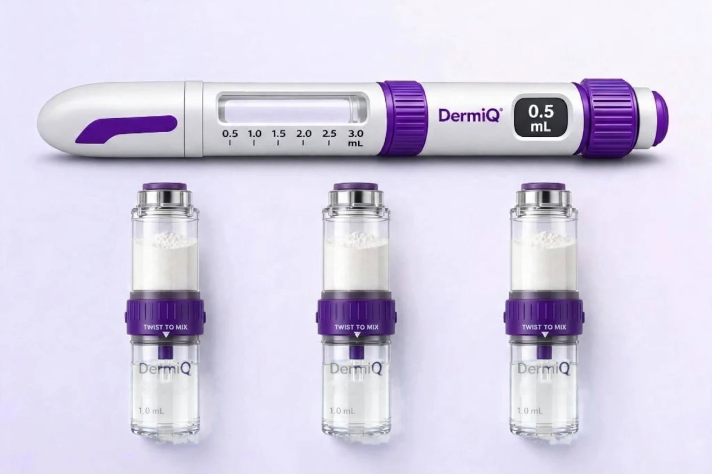

<div align="center">

  
# DermiQ
 
### The Science of Precision · علم الدقة
 
A concept prototype for a **mechanical treatment pen** and a **physician-supervised digital platform** —
public website, patient application, physician portal and patient education center, in Arabic (RTL) and English.
 


-lightgrey)
 
[**Live demo**](https://fahadb6.github.io/DermiQ/) ·
[How to Run](#how-to-run-the-project) ·
[Demo accounts](#demo-accounts) ·
[Deploy](#deployment) ·
[Documentation](#documentation) ·
 
<div align="left">

> [!IMPORTANT]
> **This is a design concept, not a product.** All people, clinics, values and records are fictional. It is **not** an approved
> medical device, **not** a clinical system and **not** medical advice. Do not enter real patient data — there is no server and
> no real security (see [`docs/SECURITY_NOTES.md`](docs/SECURITY_NOTES.md)).

</div>

---
 
## Table of Contents
 
- [What is DermiQ?](#what-is-dermiq)
- [Project Overview](#project-overview)
- [Highlights](#highlights)
- [Website Structure](#website-structure)
- [The Four Parts of the Platform](#the-four-parts-of-the-platform)
- [How to Run the Project](#how-to-run-the-project)
- [Demo accounts](#demo-accounts)
- [Suggested walkthrough](#suggested-walkthrough)
- [Deployment](#deployment)
- [Repository Structure](#repository-structure)
- [Technologies Used](#technologies-used)
- [Quality Assurance](#quality-assurance)
- [Documentation](#documentation)
- [Limitations](#limitations)
---
 
## What is DermiQ?
 
DermiQ imagines a treatment pen with a **dual-chamber cartridge and a single treatment head**, paired with a digital platform in
which **the physician decides and the patient follows**. The prototype demonstrates the platform end to end:
 
| Experience | Route | Audience |
|---|---|---|
| Public website | `/#/` | Everyone — the concept, the product and the design philosophy |
| Patient application | `/#/patient` | Patients — approved plan (read-only), session documentation, progress photos, reminders |
| Physician portal | `/#/physician` | Physicians — plan configuration, approval and digital lock, reviews, appointments, content |
| Patient Education Center | `/#/guide` · `/#/patient/education` | Shared library, "medically reviewed" (simulated) before publication |
 
Arabic is the default language (right-to-left). English is one click away and every screen exists in both.
 
## Project Overview
 
DermiQ is a front-end prototype that shows, end to end, how a mechanical treatment pen
(dual-chamber cartridge, single treatment head) could be supported by a digital platform
in which the physician decides and the patient follows.
 
**What was built.** Four connected experiences: a public website, a patient application,
a physician portal and a Patient Education Center, all using a shared browser-local data store (there is no central database).
 
**What a visitor can try.** Browse the public site and the education library, sign in with a
demo account as a physician or a patient, and follow a complete workflow: configuring and
approving a plan, locking it, documenting sessions, reviewing photos, booking appointments
and publishing education content. A suggested walkthrough is included below.
 
**Nature of the prototype.** A fully static single-page application with no server. All people,
records and values are fictional and are stored only in the visitor's browser. The full
interface is available in Arabic (right-to-left) and English.
 
## Highlights
 
- **Physician-in-control workflow.** A plan moves through draft → review → approval → *digital lock*. Re-opening a locked plan
  leaves the patient on the last approved revision until the new one is approved.
- **Live cross-tab updates.** Approve a plan in the physician tab and watch it appear in the patient tab without reloading.
- **Session documentation and progress photos** with physician review, notes and date-to-date comparison.
- **Education content lifecycle.** Article → review → approval → publication → archive, with a note and a history entry at each step.
- **Fully bilingual.** Arabic locale is type-checked against English, so a missing translation fails the build.
- **Runs anywhere static.** Relative asset paths and hash routing: any static host, any sub-path, no rewrite rules.
- **Accessible and private by design.** WCAG 2.1 AA contrast audit, no analytics, no cookies, no third-party requests —
  fonts, icons and images are all bundled.
## Website Structure
 
The application is a single-page app with hash routing, so every address works on any static
host and under any sub-path. It is organised into a public area and two role-protected areas:
 
| Area | Entry route | Access |
|---|---|---|
| Public website (home, product, design philosophy) | `/#/` · `/#/product` | Open to everyone |
| Patient Education Center | `/#/guide` | Open library; patient-only articles are locked for visitors |
| Patient application | `/#/login/patient` → `/#/patient` | Signed-in patients |
| Physician portal | `/#/login/physician` → `/#/physician` | Signed-in physicians |
 
The patient and physician areas are loaded on demand, so visitors to the public site do not
download portal code. A route guard sends anyone who is not signed in to the matching login page.
 
## The Four Parts of the Platform
 
### 1. Public Website
Introduces the concept, the product and the design philosophy. No account is needed.
 
### 2. Patient Application
- Shows the treatment plan only after the physician has approved it, always read-only.
- Lets the patient document sessions and add progress photos, with the physician's review and notes shown back.
- Compares progress photos between two dates.
- Provides appointment reminders and in-app notifications.
### 3. Physician Portal
- Works from queues of patients and items awaiting attention.
- Configures a plan and moves it through review, approval and digital lock.
- Re-opens a locked plan when needed; the patient keeps seeing the last approved revision until the new one is approved.
- Reviews documented sessions and photos, leaves notes and creates appointments.
### 4. Patient Education Center
Not a separate portal: a shared library that lives inside the other three parts and spans all three roles: visitors read the public articles, patients also
see patient-only content (inside their application at `/#/patient/education`), and physicians
manage the content lifecycle: draft → review → approval → publication → archive, with a history
entry at each step. The "medical review" is simulated.
 
All parts share one browser-local data store, so a change made in one browser tab (for example, approving
a plan) appears in the others without reloading.
 
## How to Run the Project
 
Pick the option that matches what you want to do.
 
### Option 1 — Just look at it (no install, no server)
 
Open **`DermiQ-standalone.html`** in any modern browser. It is the whole platform in a single ~3.5 MB file (code, fonts and
images inlined) and works offline.
 
> **Note:** `index.html` does **not** work when opened directly from disk — browsers block ES modules and their stylesheets on
> `file://`. Use the standalone file for that, or serve the folder (Option 2).
 
### Option 2 — Serve the production build (Node.js, zero dependencies)
 
```bash
node serve.mjs          # → http://localhost:4173
node serve.mjs 8080     # custom port
```
 
### Option 3 — Develop from source
 
Requires **Node.js 18+** (built and tested on Node 20).
 
```bash
cd source
npm install
npm run dev             # dev server  → http://localhost:5173
npm run build           # type-check + production build → source/dist/
npm run preview         # serve the production build → http://localhost:4173
npm run build:standalone  # rebuild the single-file version
```
 
## Demo accounts
 
Password for **every** account: `Demo#2026`. Both sign-in pages offer one-click buttons that fill the credentials in.
 
| Role | Name | Email | Seeded state |
|---|---|---|---|
| Physician | Dr. Lina Al-Harbi | `dr.lina@dermiq.demo` | Six patients, items waiting in every queue |
| Patient | Sara Al-Qahtani | `sara@dermiq.demo` | Plan approved and locked (rev. 2); one past session to document |
| Patient | Faisal Al-Otaibi | `faisal@dermiq.demo` | Plan approved (rev. 1); a reported session and a photo await review |
| Patient | Noura Al-Zahrani | `noura@dermiq.demo` | Plan complete, **awaiting approval** — the patient sees nothing yet |
| Patient | Khalid Al-Ghamdi | `khalid@dermiq.demo` | Draft plan, consultation booked |
| Patient | Reem Al-Shehri | `reem@dermiq.demo` | Plan re-opened (**requires review**); missed sessions; overdue follow-up |
| Patient | Omar Bakr | `omar@dermiq.demo` | Plan locked (rev. 3); a reported session awaits review |
 
The session lives per browser tab while the data is shared across tabs. Everything is stored in your browser only and can be
reset from **Settings → Reset demo data**.
 
## Suggested walkthrough
 
1. Open the site (Arabic, RTL) and switch to English from the header.
2. Search the Patient Guide; note that patient-only articles are locked for visitors.
3. Sign in as **Dr. Lina** → open **Noura Al-Zahrani → Configuration**. The preview panel shows the patient sees nothing.
4. In a second tab sign in as **Noura**: "Your plan is being prepared" — no dose anywhere.
5. As the physician: choose a dose, save, **Review Changes**, **Approve Treatment Plan** → the patient tab updates live, read-only.
6. **Digitally Lock** the plan → inputs become read-only. **Update Plan** re-opens it; the patient keeps the last approved version.
7. Create an appointment → it appears in the patient's reminders with an in-app notification.
8. Sign in as **Sara**: **Start Session** opens an educational walkthrough and records nothing.
9. Sara documents the past session manually (confirmation checkbox required) → the physician reviews it and leaves a note.
10. Sara adds a progress photo (a synthetic sample is provided); the physician marks it reviewed; Sara compares two dates.
11. Physician → **Education content**: move an article through review → approval → publication → archive.
## Deployment
 
The build is fully static, uses **hash routing** (`/#/product`) and **relative asset paths** (`base: './'`), so it runs from a
domain root or from a sub-path such as `https://user.github.io/repo/` with no configuration.
 
### GitHub Pages
 
1. Push the **contents of this folder** to the repository root, so that `index.html` sits at the top level.
2. Go to **Settings → Pages**.
3. Under **Build and deployment**, set **Source** to *Deploy from a branch*, choose your branch (e.g. `main`) and the
   **`/ (root)`** folder, then **Save**.
4. After a minute the site is live at `https://<username>.github.io/<repository>/`.
A `.nojekyll` file is included so GitHub does not run Jekyll over the build. `404.html` sends any unknown address back to the
home page and is aware of the `/<repository>/` sub-path.
 
### Netlify and other static hosts
 
Drag the folder that **directly contains `index.html`** onto the host's deploy area. `_redirects` (Netlify and compatible hosts)
returns unknown addresses to the home page and keeps `source/`, `docs/` and `serve.mjs` away from visitors. GitHub Pages ignores
`_redirects`; there, `source/` and `docs/` are simply public, as in any open repository.
 
### Updating the deployed site after code changes
 
```bash
cd source
npm install
npm run build                 # produces source/dist/
cp -r dist/* ..               # overwrite index.html and assets/ at the repository root
```
 
Commit and push; Pages redeploys automatically. Note that asset file names are content-hashed, so remove stale files from
`assets/` first if you want a clean tree.
 
## Repository Structure
 
```
.
├── index.html · assets/ · demo/ · favicon.svg   Production build — what visitors see
├── 404.html · _redirects · .nojekyll            Hosting rules (any wrong address returns home)
├── DermiQ-standalone.html                       The whole platform in one file; double-click to open
├── serve.mjs                                    Zero-dependency static server for the build
├── docs/                                        Architecture, data model, design system, governance, security, QA
└── source/                                      Full source code
    ├── src/
    │   ├── app/             Router, role guards, lazily loaded patient and physician areas
    │   ├── layouts/         Public, patient and physician layouts
    │   ├── features/        public · education · authentication · patient · physician
    │   ├── components/      brand · ui · product · domain · charts
    │   ├── services/        db.ts (store + business rules) · auth · i18n · selectors · storage
    │   ├── data/            seed, product, FAQ and education content
    │   ├── locales/         en/ and ar/ (ar is type-checked against en)
    │   ├── types/           The data model
    │   └── styles/          Tailwind entry and design tokens
    ├── public/              Synthetic demo photos and hosting rules copied into every build
    ├── qa/                  Playwright scripts (end-to-end, crawl, contrast, widths, …)
    └── tools/               Standalone builder, packaging script, asset pipeline (provenance only)
```
 
## Technologies Used
 
| Concern | Choice |
|---|---|
| UI | React 18, React Router 6 (`HashRouter`), Zustand |
| Language | TypeScript (strict) |
| Build | Vite 5 — relative base, route-level code splitting |
| Styling | Tailwind CSS 3 with design tokens; logical properties for RTL/LTR |
| Icons and type | lucide-react; self-hosted Alexandria, Fraunces, Manrope, IBM Plex Sans Arabic and IBM Plex Mono |
| Persistence | `localStorage` (data) and `sessionStorage` (session) — no backend |
| Testing | Playwright scripts in `source/qa/` |
 
## Quality Assurance
 
Browser checks live in `source/qa/` and are described, with the results of the last run, in
[`docs/QA_REPORT.md`](docs/QA_REPORT.md).
 
```bash
cd source
npm run typecheck
 
# one-off setup for browser checks
npm i -D playwright && npx playwright install chromium
 
npm run dev &
node qa/e2e.mjs          # 20-step flow: site, physician portal and patient app
node qa/crawl.mjs public # also: patient, physician — every route, both languages, two viewports
node qa/contrast.mjs     # WCAG 2.1 AA text-contrast audit
node qa/no-storage.mjs   # the app still works when Web Storage is blocked
node qa/standalone.mjs   # the single-file build, sandboxed and from file://
node qa/widths.mjs all   # no horizontal overflow at 15 widths (about four minutes)
```
 
## Documentation
 
| Document | What it covers |
|---|---|
| [`docs/ARCHITECTURE.md`](docs/ARCHITECTURE.md) | How the application is put together and how it would grow a back end |
| [`docs/DATA_MODEL.md`](docs/DATA_MODEL.md) | Entities, state machines and business rules |
| [`docs/DESIGN_SYSTEM.md`](docs/DESIGN_SYSTEM.md) | Tokens, typography, components, RTL and accessibility rules |
| [`docs/MEDICAL_CONTENT_GOVERNANCE.md`](docs/MEDICAL_CONTENT_GOVERNANCE.md) | What the product may and may not say |
| [`docs/SECURITY_NOTES.md`](docs/SECURITY_NOTES.md) | What is simulated and what production would require |
| [`docs/ASSETS_AND_REFERENCE_NOTES.md`](docs/ASSETS_AND_REFERENCE_NOTES.md) | Imagery provenance, retouching, open discrepancies |
| [`docs/QA_REPORT.md`](docs/QA_REPORT.md) | What was tested and what is known to be missing |
 
## Limitations
 
No server, no real authentication, no real notifications (in-app only), no connection to the pen (it is mechanical), no clinical
validation and no regulatory status. Photos and records never leave the browser. Medical content is illustrative and has not been
reviewed by a clinician.
 
